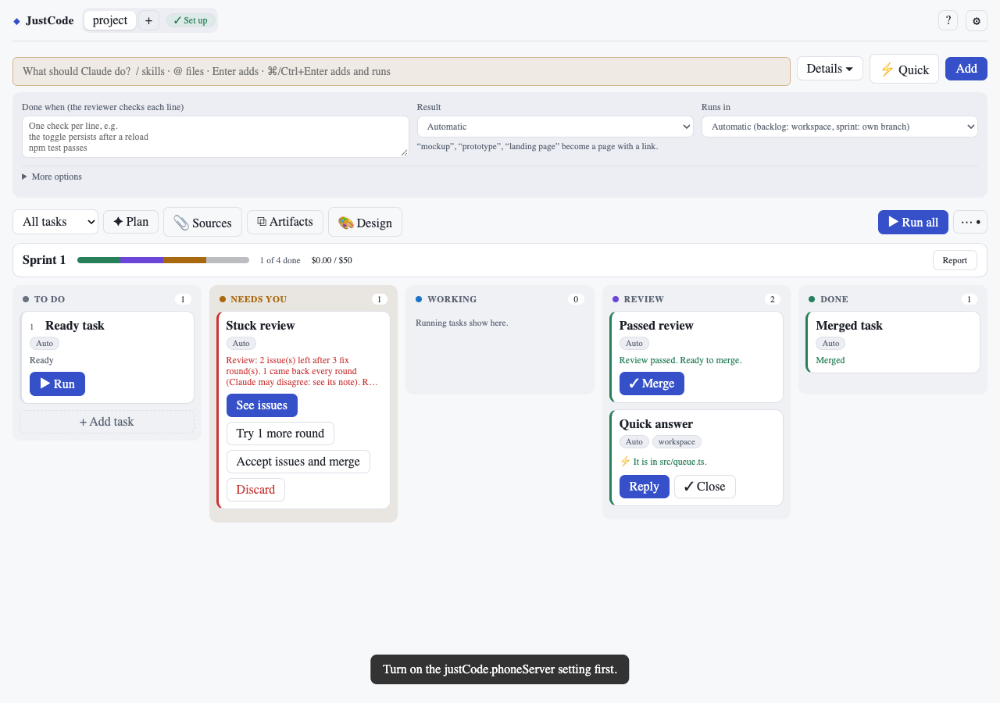
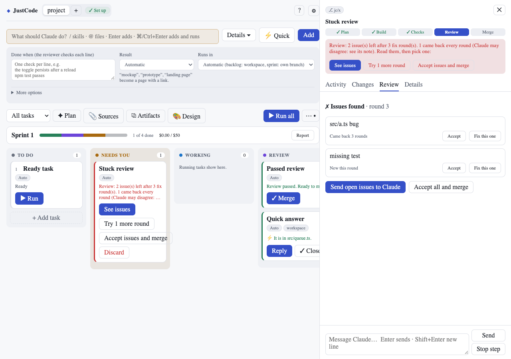
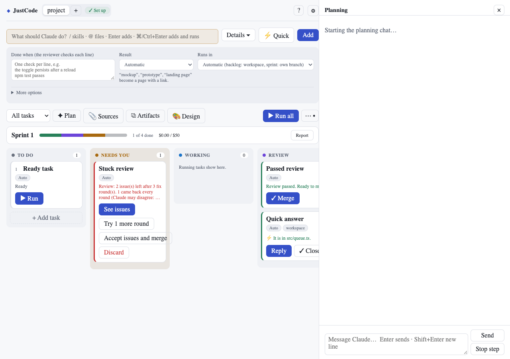

# ◆ JustCode

**A task board for VS Code that runs Claude Code on every task.** 
Own branch per task · approvals on the card · AI review · one-click merge

## Why JustCode

| | |
|---|---|
| 🗂 **One card per task** | Type what you want. Sprint tasks build on their own branch in their own folder; small backlog tasks work in your project folder. Either way you see the change before it is committed. |
| ⚡ **Quick when it's small** | **⚡ Quick** runs a question or a small edit right away in your project folder: no branch, no review. |
| ✋ **Approvals on the card** | Claude approves what is safe and asks about the rest: **Allow**, **Always allow** or **Deny**. |
| ✅ **Checked before you look** | Your tests run after every step, then an AI reviewer checks the change. Problems go back to Claude first. |
| 🔀 **One-click merge** | Press **✓ Merge** when the review passes. Conflicts are fixed in the task's folder, not yours. |

| Review the work | Plan with Claude |
|---|---|
|  |  |
| Each task shows its activity, changes, review and details. | **✦ Plan** turns a goal into small tasks in build order. |

## Install

You need VS Code 1.90 or newer (or an editor built on it, such as Devin or Cursor), [git](https://git-scm.com), and
[Claude Code](https://code.claude.com). The board's setup checklist installs and signs in Claude Code for you.

1. Download the `.vsix` file from the [latest release](https://github.com/JustineQinLao/just-code-ai/releases/latest).
2. In your editor, open the Extensions view (**⌘⇧X** / **Ctrl+Shift+X**), click **⋯**, choose **Install from VSIX…**
   and pick the file.
3. Run **Developer: Reload Window**.

To build it yourself: `npm install && npm run package`, then install the `just-code-<version>.vsix` it writes.

## Quick start

1. Run **JustCode: Open Board**, or click **JustCode** in the status bar.
2. Fix any red line in the **setup checklist**. Each one has a button that fixes it.
3. Type a task, for example *"Add a dark mode toggle to the settings page"*, and press **⌘/Ctrl+Enter** to add and
   run it. For a quick question or a one-line change, press **⚡ Quick** instead.
4. Watch the card move:
   - **Working**: Claude is building.
   - **Needs you**: Claude asked something or wants approval. Answer on the card.
   - **Review**: tests ran and the AI reviewer checked it. Press **✓ Merge**.

Press **?** on the board for the full guide.

## What else it does

- **Plan and sprints:** **✦ Plan** breaks a goal into tasks with a *Done when* checklist, grouped into sprints with a
  progress bar. **▶ Run all** builds them in order, each one after the one it depends on.
- **Mockups and pages:** a task that asks for a mockup or a page becomes a web page published to claude.ai, with the
  link on the card. **⧉ Artifacts** lists every page and link the project has used.
- **Your design:** **🎨 Design** writes a design guide from the styles your code already uses, so new screens match.
- **Sources:** attach specs, designs, docs and links under **📎 Sources**; Claude reads them before it starts.
- **Budgets and rules:** a cost limit per task and sprint, and files Claude may not change, in `.justcode/policy.json`.
- **Stays out of your repo:** everything JustCode keeps is in `.justcode/`, which is never committed.

## Safety

- Every change waits for you: a branch task until you press **✓ Merge**, a task in your project folder until you
  press **Finish** (commit) or **Discard**.
- Before JustCode commits, it checks the change for keys and tokens and stops if it finds any.
- `.env` files, keys and `node_modules` stay out of git. Your `.gitignore` is not changed.
- *Bypass permissions* (no approvals at all) asks you to confirm before it is turned on.
- An `ANTHROPIC_API_KEY` in your environment is not used unless you choose **JustCode: Use an Anthropic API Key**.

## Troubleshooting

- **A red line in the setup checklist:** press the button next to it.
- **`claude` is not found:** set `justCode.claudePath` to its full path.
- **A task waits under Needs you:** open the card and answer, or press Allow or Deny.
- **Merge conflict:** press **Resolve with Claude** on the card.
- **Something else:** open View › Output › *JustCode* for the log, or press **?** on the board.

## Limits

- Windows has not been tested yet.
- Using a Claude plan login through the Agent SDK is meant for your own use. Anthropic's terms do not allow offering
  claude.ai login inside products you distribute to others without their approval; use an API key for that.
